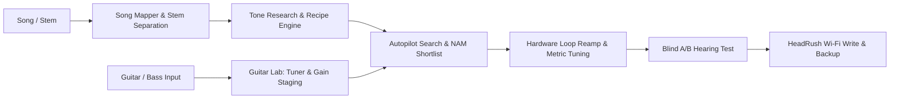

<div align="center">

# rigsmith

**Autonomous Tone Engineering and Remote Control for HeadRush Core / Prime**

*Recreate recorded guitar and bass tones on hardware modelers over Wi-Fi — automated, measured, and verified.*

[](LICENSE)
[](https://www.python.org/)
[](https://fastapi.tiangolo.com)
[](tests/)

[Features](#features) • [Quickstart](#quickstart) • [Workflow](#workflow) • [CLI Reference](#cli-reference) • [Safety](#safety) • [License](#license)

</div>

---

## Overview

Rigsmith connects HeadRush Core and Prime modelers directly to audio analysis and optimization pipelines.

Instead of manually guessing amp voicings, IRs, and EQ curves by ear, Rigsmith:

1. **Analyzes songs and stems**: Isolates guitar/bass tracks, transcribes chords and voicings, detects tunings, and measures spectral and dynamic envelopes.
2. **Researches historic rigs**: Resolves production notes and gear records to match original amps, cabs, mics, and pickups.
3. **Profiles your instrument**: Interactive lab with chromatic and string tuning down to 25 Hz (supporting 4, 5, and 6-string bass), audio interface gain coaching, and pickup voice modeling.
4. **Optimizes hardware over Wi-Fi**: Controls HeadRush units via their remote editor protocol, auditioning candidate amps, cabs, and NAM captures through an audio interface loop to minimize Error-to-Signal Ratio (ESR).
5. **Double-blind verification**: Produces automated blind A/B trials and writes multi-scene rigs directly to hardware memory.

Available via browser UI, CLI, and Model Context Protocol (MCP) server for integration with agent runtimes.

---

## Features

- **Autopilot**: Ingest audio stems or songs to automatically analyze tone, construct candidate rigs, run reamp sweeps, and compile ready-to-use presets.
- **Guitar & Bass Lab**:
  - Chromatic and open-string tuner supporting standard guitars and extended-range/drop-tuned bass down to 25 Hz ($A_0$, $B_0$, $E_1$).
  - Gain staging meter with real-time headroom feedback and audio interface input gain coaching.
  - Duplex hardware pass-through monitoring and one-click test clip recording/playback.
  - Guided session protocols to map fretboard coverage and train pickup harmonic models.
- **Hardware Loop & NAM Integration**:
  - Sample-aligned reamping across analog, USB, and hybrid loop routes.
  - Native support for Neural Amp Modeler (NAM A1/A2) captures and impulse responses.
  - Automated parameter search across gain stages, tonestacks, presence, and master volume.
- **Hardware Safety**:
  - Zero firmware modifications or binary patching; communicates strictly via native remote network protocols.
  - Mandatory backup verification before any preset write operation.
  - Network listener defaults to local loopback with origin validation and DNS rebinding protections.
- **MCP & Tooling Support**:
  - Full MCP tool definitions for external LLMs and CLI workflows.
  - Global navigation and quick-action command palette.

---

## Quickstart

### 1. Installation

```bash
git clone https://github.com/Gavinboley/rigsmith.git
cd rigsmith
pip install -e ".[all]"
rigsmith doctor
```

### 2. Launch the Web Interface

```bash
rigsmith ui
```

The interface launches locally and opens in your default browser.

### 3. Connect to HeadRush Hardware

1. Connect your HeadRush Core/Prime to the same local network as your workstation.
2. On the unit, enable **Global Settings -> Wi-Fi -> HeadRush Remote**.
3. Pair the device:
   ```bash
   rigsmith discover
   rigsmith device pair
   ```

---

## Workflow



1. **Stem Separation**: Demucs extracts dry instrument stems; pitch trackers isolate chord voicings and playing techniques.
2. **Instrument Staging**: Connect your instrument through an audio interface, verify levels in the target input range, tune, and run a short calibration sequence.
3. **Tone Matching**: Rigsmith compares reamped takes against source references, optimizing frequency response, compression, and harmonic distortion.
4. **Hardware Sync**: Finalized rigs, calibrated scenes, delay times, and IR assignments write to the unit with full backup logs.

---

## CLI Reference

| Task | Command |
|---|---|
| Launch Web Interface | `rigsmith ui` |
| Environment Check | `rigsmith doctor` |
| Discover Network Devices | `rigsmith discover` |
| Run Autopilot Demo | `rigsmith autopilot demo` |
| Run Autopilot on Track | `rigsmith autopilot run "Song Title" --artist "Artist" --mix track.flac` |
| Test Loop Wiring | `rigsmith loop test` |
| Record DI Take | `rigsmith loop record 10 --device "Analog 1/2"` |
| Inspect Rig Configuration | `rigsmith rig show "MyRig"` |

---

## Safety

- **Local Network Scope**: The web interface binds to loopback by default and verifies host headers to block cross-site scripting and DNS rebinding.
- **State Backups**: Writes require an existing device backup snapshot in `~/.rigsmith/backups`.
- **Read-Only Mode**: Set `RIGSMITH_READONLY=1` to disable state mutations on connected hardware.
- **Hardware Recovery**: Holding footswitches 4 and 5 during device boot restores factory settings at any time.

---

## License

This software is released under the **PolyForm Noncommercial License 1.0.0**.

- Free for personal use, hobbyist experimentation, research, and non-commercial educational study.
- Source code may be modified and redistributed with attribution to Gavin Boley.
- Commercial distribution, commercial hosting, and commercial software integration are prohibited without a separate license.

See the complete [LICENSE](LICENSE) text for details.
